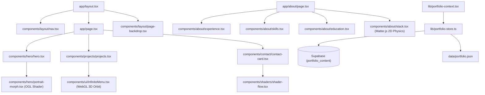

# Carte des packages

| Package | Chemin | Responsabilité | Depend de |
|---|---|---|---|
| `app` | `app/` | Routes Next.js App Router, SSR, Metadata & Layouts | `components`, `lib` |
| `components/hero` | `components/hero/` | Section Hero, CTAs & Shader OGL PortraitMorph | `lib`, `components/ui` |
| `components/projects` | `components/projects/` | Grille de réalisations & Menu 3D InfiniteMenu WebGL | `lib`, `components/ui` |
| `components/about` | `components/about/` | Expériences, compétences, éducation & Stack Matter.js | `lib`, `components/ui` |
| `components/contact` | `components/contact/` | Carte de contact, ShaderFlow & CTAs réseaux | `lib`, `components/shaders` |
| `lib` | `lib/` | Données locales, client Supabase, gestion de session et contexte | Supabase, React |

